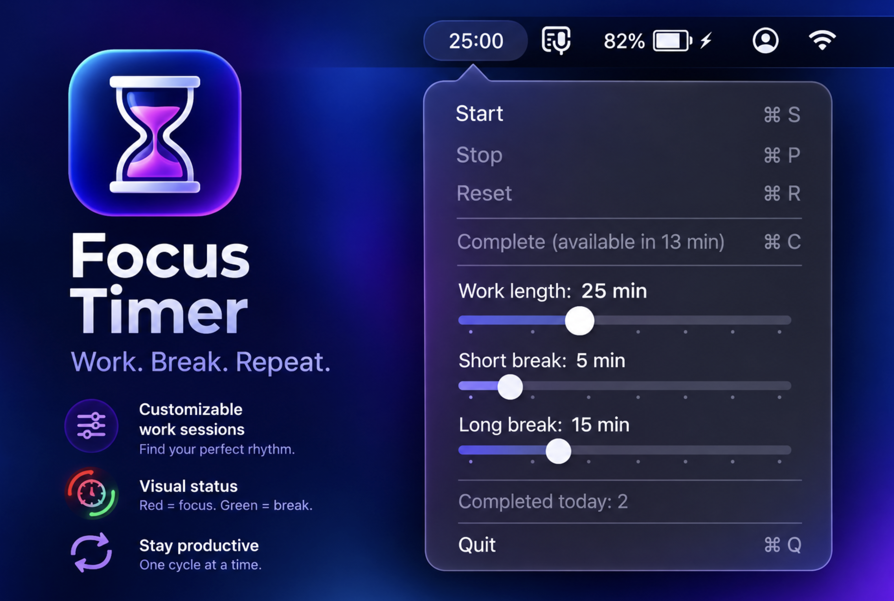

# p-timer-mac

A minimalistic work/break timer for the macOS menu bar.

- 25 minutes of work (adjustable from 15 to 60), then a 5-minute break (5 to 20); after every 4th work interval of the day the break is 15 minutes (10 to 30).
- Work starts only manually; the break starts automatically when work ends.
- Lives only in the menu bar, showing just `MM:SS` with no icon. No windows, no Dock icon, no notifications.
- A short sound plays when an interval runs out.
- The menu shows how many work intervals you completed today.
- About 290 KB, no dependencies. Universal: Apple Silicon and Intel, macOS 13+.



## Installation

1. Download `p-timer-mac.dmg` from [Releases](https://github.com/SlavaYakovenko/p-timer-mac/releases), open it and drag `p-timer-mac` into `Applications`.
2. Launch it. `25:00` appears in the menu bar.

The app is ad-hoc signed (no Apple Developer ID), so macOS may block a downloaded DMG on first launch. If so, right-click the app → Open, or run
`xattr -dr com.apple.quarantine /Applications/p-timer-mac.app`.

Launch at login: System Settings → General → Login Items → add p-timer-mac.

Only one copy runs at a time: launching it again does nothing.

## Usage

Click the timer in the menu bar to open the menu:

- **Start / Resume** — start the timer, or continue after a pause;
- **Stop** — pause the work timer; during a break, end the break early and return to the full work length, waiting for Start;
- **Reset** — reset to the full work length (during a break, this ends it like Stop);
- **Complete** — available once more than half of the current work interval has passed (running or paused): counts it in "Completed today" and resets the timer to the full work length, without a break or sound. Until then it is disabled and shows how many minutes are left before it unlocks, e.g. "Complete (available in 3 min)";
- **Work length: N min** — a slider from 15 to 60 minutes in 5-minute steps (default 25). It applies from the next work interval; an untouched timer changes right away, while a running or paused one keeps its length. The setting is remembered;
- **Short break: N min** — a slider from 5 to 20 minutes in 5-minute steps (default 5);
- **Long break: N min** — a slider from 10 to 30 minutes in 5-minute steps (default 15). The long break is never shorter than the short one: raising the short break above it moves the long break up to match, and lowering the long break below the short one moves the short break down. Both break lengths apply from the next break (a running break keeps its length) and are remembered;
- **Completed today: N** — how many work intervals were completed today, by running out or with Complete (informational; resets at midnight);
- **Quit** — quit.

When the work time runs out, a sound plays and the break starts right away: the short break, or the long one after every 4th interval today that ended with a break (intervals ended with Complete don't count toward it). The break time is shown in green, so a running break catches the eye. When the break ends, the sound plays again, the timer returns to the full work length and waits to be started manually. Until you press Start, the time is shown in red, so a forgotten timer stands out; the red is cleared when a new day starts. A paused work interval is shown in red too, whether you pressed Stop or closing the lid paused it, so you don't forget to resume. A break ended early with Stop or Reset plays no sound and isn't shown in red.

## Building

Only Xcode Command Line Tools are required (`xcode-select --install`).

```sh
./build.sh
```

Output:

- `build/p-timer-mac.app` — the app (~290 KB, ~90 KB of which is the icon);
- `build/p-timer-mac.dmg` — the installer image (~250 KB).
