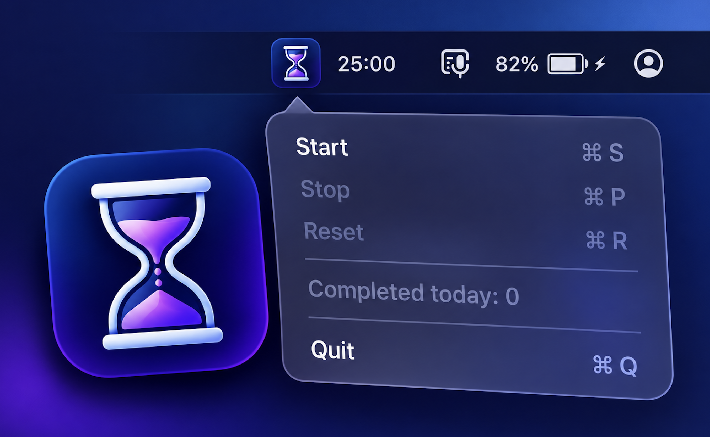

# p-timer-mac

A minimalistic work/break timer for the macOS menu bar.

- 25 minutes of work (adjustable from 15 to 60), then a 5-minute break; after every 4th work interval of the day the break is 15 minutes.
- Work starts only manually; the break starts automatically when work ends.
- Lives only in the menu bar, showing just `MM:SS` with no icon. No windows, no Dock icon, no notifications.
- A short sound plays at the end of each interval.
- The menu shows how many work intervals you completed today.
- About 280 KB, no dependencies. Universal: Apple Silicon and Intel, macOS 13+.



## Installation

1. Download `p-timer-mac.dmg` from [Releases](https://github.com/SlavaYakovenko/p-timer-mac/releases), open it and drag `p-timer-mac` into `Applications`.
2. Launch it. `25:00` appears in the menu bar.

The app is ad-hoc signed (no Apple Developer ID), so macOS may block a downloaded DMG on first launch. If so, right-click the app → Open, or run
`xattr -dr com.apple.quarantine /Applications/p-timer-mac.app`.

Launch at login: System Settings → General → Login Items → add p-timer-mac.

Only one copy runs at a time: launching it again does nothing.

## Usage

Click the timer in the menu bar to open the menu:

- **Start / Resume** — start the timer, or continue after a pause;
- **Stop** — pause;
- **Reset** — reset to the full work length;
- **Work length: N min** — a slider from 15 to 60 minutes in 5-minute steps (default 25). It applies from the next work interval; an untouched timer changes right away, while a running or paused one keeps its length. The setting is remembered;
- **Completed today: N** — how many work intervals were fully completed today (informational; resets at midnight);
- **Quit** — quit.

When the work time runs out, a sound plays and the break starts right away: 5 minutes, or 15 after every 4th interval completed today. The break time is shown in green, so a running break catches the eye. When the break ends, the sound plays again, the timer returns to the full work length and waits to be started manually. Until you press Start, the time is shown in red, so a forgotten timer stands out; the red is cleared when a new day starts. A paused work interval is shown in red too, whether you pressed Stop or closing the lid paused it, so you don't forget to resume.

## Building

Only Xcode Command Line Tools are required (`xcode-select --install`).

```sh
./build.sh
```

Output:

- `build/p-timer-mac.app` — the app (~280 KB, ~90 KB of which is the icon);
- `build/p-timer-mac.dmg` — the installer image (~250 KB).
